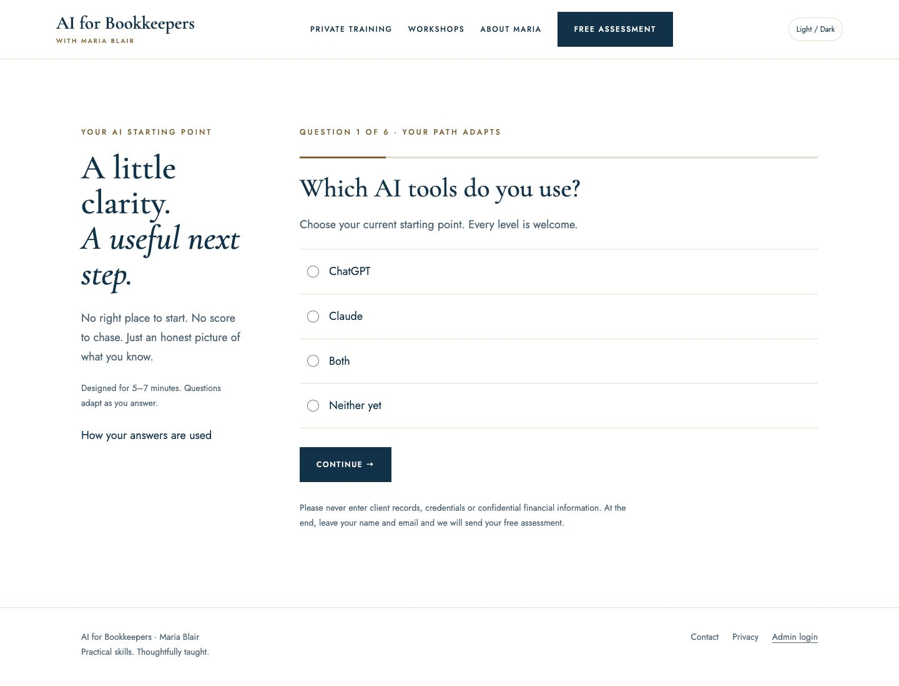

# AI for Bookkeepers

**An adaptive skills assessment and consultant workspace for practical AI training.**

Next.js · React · TypeScript · Cloudflare D1 · Cloudflare Access · Workers

**[Explore the live app](https://ai-for-bookkeepers.mashablair.workers.dev)** · [Run locally](#run-locally)

This application turns a broad question, “How could AI help my bookkeeping practice?”, into a structured training conversation. Visitors follow an assessment tailored to their experience, request a personally reviewed assessment or training session, and the consultant reviews the answers and prepares workshop notes in a protected workspace.

The project focuses on product-oriented front-end engineering: conditional form flows, clear feedback, accessible controls, server-side validation, and the connection between a public customer journey and an administrator’s workflow.

Built by **[Maria Blair](https://github.com/mashablair)** to connect a thoughtful customer-facing assessment with a practical consulting workflow.



*Working local application, captured without client information or backend credentials.*

[Try it locally](#try-it-without-credentials) · [Engineering highlights](#engineering-highlights) · [Verification notes](docs/PORTFOLIO_CHECK.md)

## Explore the product

| Area | What it does |
| --- | --- |
| Marketing pages | Introduces private training and team workshops with a responsive editorial layout and persistent light/dark themes. |
| Adaptive assessment | Adjusts questions to a visitor’s tools and experience, removes answers that no longer apply, and retains an in-progress draft in the current tab. |
| Assessment request | Collects consent and contact details after the questionnaire for personal review and follow-up. |
| Consultant workspace | Lists requests and assessments, filters by referral source, updates lead status, and saves manually written, reviewed workshop notes. |
| Measurement | Associates assessments with later requests and records conversion events after successful database inserts. |

**Current workflow:** assessment summaries are deterministic, not AI-generated. The visitor-facing results page requests personal review; it does not display an automatically generated report. Workshop notes are written and saved by the consultant. The current application does not generate agendas with an LLM or automatically email assessment reports. The presence of an OpenAI package in the dependency list is not an implemented AI integration.

There is no online payment or calendar-booking flow. A form submission requests follow-up; it does not book or charge for training.

## Engineering highlights

- **One conditional question model:** the UI and server use shared assessment rules, including removal of stale answers when the visitor changes their path.
- **Accessible interaction design:** semantic fieldsets and controls, focus movement between questions, visible errors and progress, responsive layouts, and browser tests with axe checks.
- **Explicit failure states:** without backend configuration, a visitor can explore the assessment, but contact submissions report that they were not sent rather than displaying a false success.
- **Layered authorization:** Cloudflare Access plus server-side verification of JWT signature, issuer, audience, expiration, and the authorized administrator email.
- **Protected request handling:** schema validation, origin checks, bounded request bodies, honeypot/timing checks, and rate limits. The database is accessed only through a server-side D1 binding.
- **Retry-aware measurement:** unique request IDs and database-triggered conversion events avoid counting form clicks or repeated submissions as new conversions.

## Run locally

Requires **Node.js 22+** and npm.

```sh
npm ci
cp .env.example .env.local
npm run dev
```

Open **http://127.0.0.1:3000** and set `NEXT_PUBLIC_SITE_URL=http://127.0.0.1:3000` in `.env.local`. The configured origin must match the address used in the browser.

### Try it without credentials

Start at `/assessment`. Choose either a beginner or experienced path, go back and change an answer, and complete the questions. The assessment state is retained in the current browser tab. Persistence requires a D1 binding and a signing secret, and the email-request form returns an explicit not-sent message. `/admin` redirects to login; there is no demo authentication bypass.

Use fictional examples only. Do not enter client financial records, identifying client details, or account credentials.

### Enable persistence and the consultant workspace

1. Bind a dedicated D1 database as `DB` in `wrangler.jsonc` and apply `migrations/0001_initial.sql` with `wrangler d1 migrations apply ai-for-bookkeepers --local` (or `--remote` for deployment).
2. Configure a random `SESSION_SECRET` of at least 32 characters. Local D1 is automatically available through OpenNext during `npm run dev`.
3. Protect both `/admin` and `/api/admin` with one Cloudflare Access application, using an Allow policy for the owner's email only. Leave public assessment and contact routes outside Access.
4. Set `ACCESS_ISSUER` to the team's HTTPS Access origin, `ACCESS_AUD` to the application audience, and `ADMIN_EMAIL` to the permitted email. Every private data route validates the signed identity independently.

| Variable | Purpose |
| --- | --- |
| `NEXT_PUBLIC_SITE_URL` | Canonical origin for request validation and site URLs. |
| `SESSION_SECRET` | Server-only signing secret for assessment cookies. |
| `ACCESS_ISSUER` | Expected Cloudflare Access team origin. |
| `ACCESS_AUD` | Expected Access application audience. |
| `ADMIN_EMAIL` | Explicit authorized administrator email. |
| `PUBLIC_INDEXING` | Search-indexing opt-in; defaults off. |

Generate a signing secret with `openssl rand -hex 32`. Never commit `.env.local`, secrets, or production data. Run `npm run check:config` to check required setting presence without printing values; this does not verify external account access.

A signed HttpOnly cookie connects an assessment to a later request for 24 hours. No public record-lookup endpoint is provided.

## Code map

```text
src/app/                 Pages and server API routes
src/components/          Site shell, assessment, request forms, admin controls
src/lib/                 Assessment rules, validation, authorization, request safety
src/proxy.ts             Private response cache controls
migrations/              D1 schema, constraints, indexes and conversion triggers
tests/                   Assessment, database, request and security tests
tests/e2e/               Desktop/mobile journeys and axe accessibility checks
docs/                    Product context, deployment and earlier validation notes
```

Useful entry points: [question model](src/lib/assessment.ts), [assessment UI](src/components/assessment.tsx), [results/request UI](src/components/results.tsx), [administrator agenda handler](src/app/api/admin/agenda/route.ts), and [authorization](src/lib/access.ts).

## Validation

```sh
npm test
npm run typecheck
npm run build
# With the local app running at http://127.0.0.1:3000:
npm run test:e2e
# Build the Cloudflare-compatible Worker bundle; does not deploy:
npm run build:cloudflare
```

Unit tests cover assessment rules, request validation, signed ownership cookies and Access JWT rejection cases. Database integration tests run the actual D1 migration in Miniflare and check linked requests, deduplication, conversion triggers, foreign keys and admin edits. `node scripts/test-admin-integration.mjs` exercises the real Next.js admin page and APIs against local D1 with an isolated test issuer; it creates no production authentication bypass.

## Deployment and boundaries

Cloudflare packaging uses OpenNext. Deploy with `npm run build:cloudflare` followed by `wrangler deploy --keep-vars`. Apply migrations before deploying code that needs them. Preserve Access configuration and verify both private paths after deployment.

The public application accepts assessment and consultation requests. Reports and replies are prepared and sent manually. Historical Supabase migrations and older deployment plans are retained for reference; current infrastructure is D1 and Access. No additional Supabase project is needed.

See [verification notes](docs/PORTFOLIO_CHECK.md) for tested behavior and deployment status.
